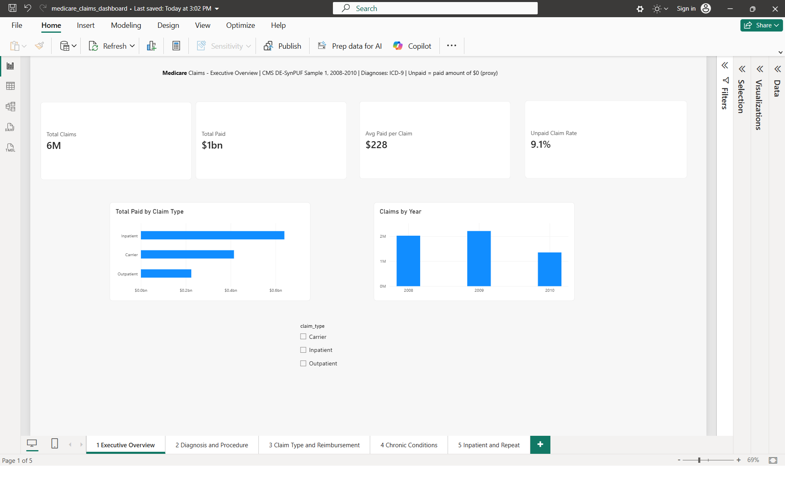
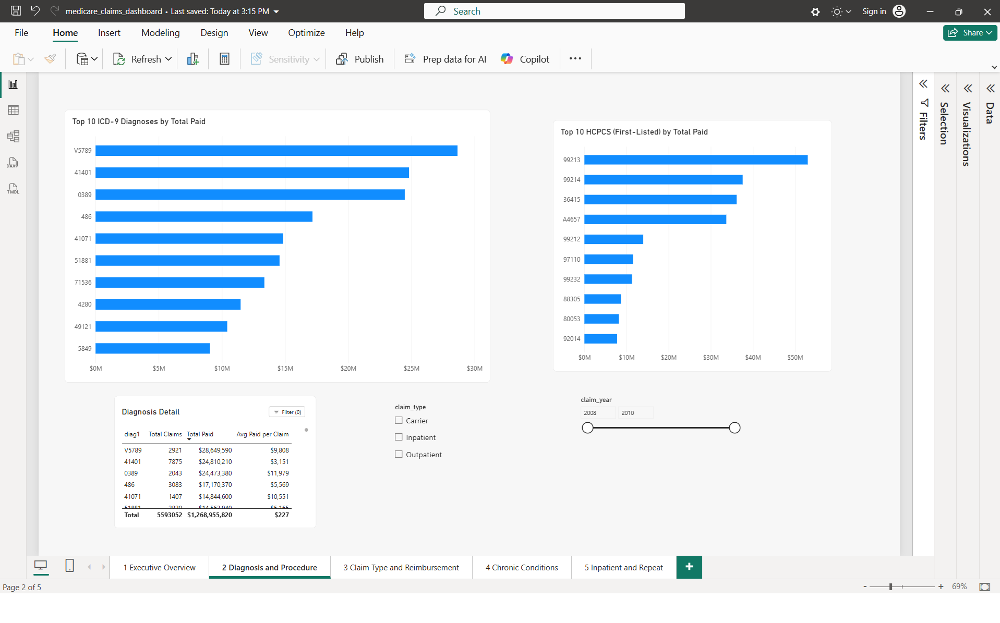
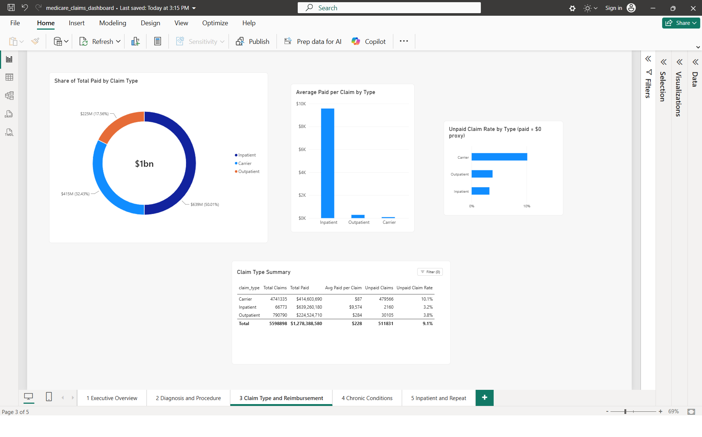
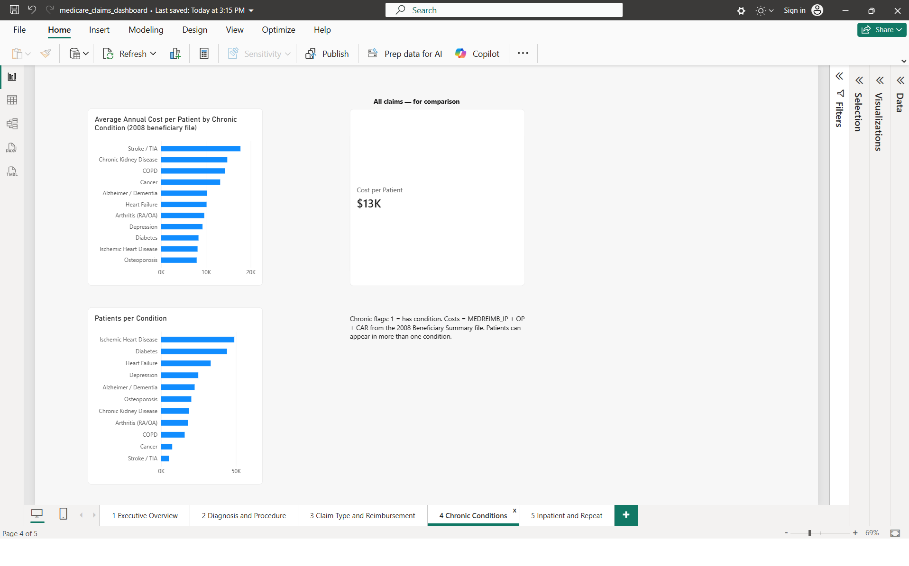
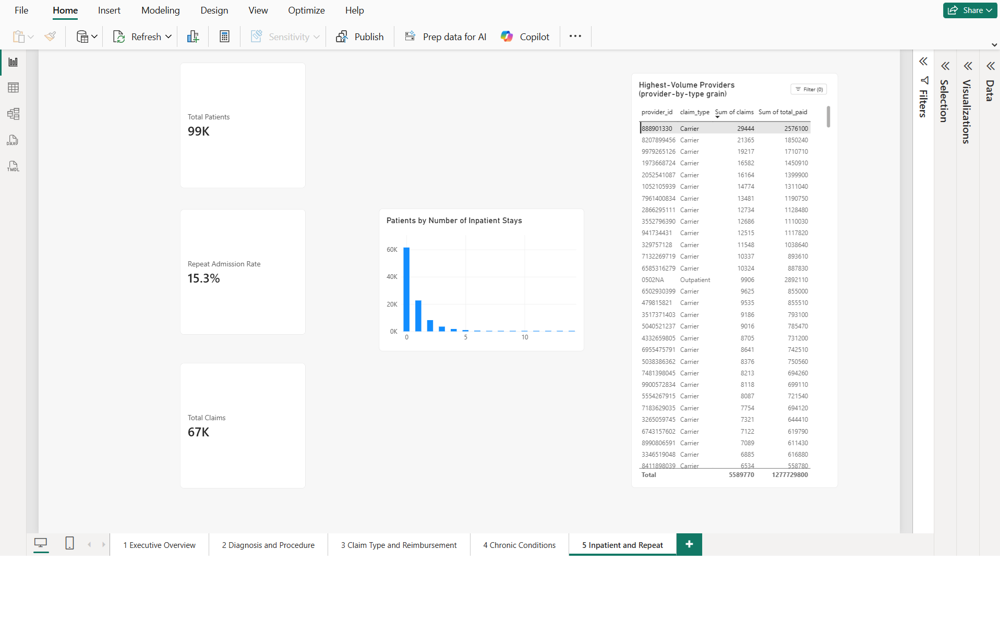

# Medicare Claims, Unpaid-Claim and Reimbursement Analysis
CMS DE-SynPUF (synthetic Medicare data) - SQL, Python (Pandas), Power BI

## Business questions
Where does Medicare spend the most? Which ICD-9 diagnoses and
HCPCS procedures cost the most? How many claims go unpaid?
Which chronic conditions cost the most per patient?
How many patients have repeat inpatient stays?

## Data
CMS DE-SynPUF, Sample 1 only. Beneficiary Summary 2008;
Inpatient, Outpatient, Carrier (A+B) and Prescription Drug
Event claims, 2008-2010. Rows loaded: beneficiary 116,352,
inpatient 66,773, outpatient 790,790, carrier 4,741,335, PDE 5,552,421.
Full notes: data_notes/data_dictionary.md

## Definitions (read before quoting any number)
- Diagnoses are ICD-9 (data predates ICD-10).
- Unpaid claim = paid amount of $0. The data has NO denial
  flag or denial reason; this is a proxy, not a denial rate.
- Carrier paid = SUM of LINE_NCH_PMT_AMT_1 to _13.
- Chronic flags: 1 = has condition, 2 = does not.
- Repeat stay = patient with 2+ inpatient claims in
  2008-2010 (not the CMS 30-day readmission measure).

## Headline results (all computed in sql/ and notebooks/)
- Total claims: 5,598,898  |  Total paid: $1,278,388,580
- Highest-spend claim type: Inpatient ($639,260,180, 50.0% of paid)
- Top ICD-9 diagnosis by paid: V5789 - Care involving other
  specified rehabilitation procedure ($28,649,590)
- Unpaid claim rate: Inpatient 3.2% | Outpatient 3.8%
  | Carrier 10.1%
- Costliest chronic condition per patient: Stroke/TIA ($17,717.87/yr)
- Patients with repeat stays: 15,168 (40.15% of patients with a hospital stay)

## Top 10 diagnoses by paid (ICD-9, with plain names)
- V5789 - Care involving other specified rehabilitation procedure - $28,649,590
- 41401 - Coronary atherosclerosis of native coronary artery - $24,810,210
- 0389 - Unspecified septicemia - $24,473,380
- 486 - Pneumonia, organism unspecified - $17,170,370
- 41071 - Subendocardial infarction, initial episode of care - $14,844,600
- 51881 - Acute respiratory failure - $14,563,940
- 71536 - Osteoarthrosis, localized, not specified whether primary or secondary, lower leg - $13,362,360
- 4280 - Congestive heart failure, unspecified - $11,482,170
- 49121 - Obstructive chronic bronchitis with (acute) exacerbation - $10,422,780
- 5849 - Acute kidney failure, unspecified - $9,054,000
Codes are shown as stored in the data, without the dot
(V5789 = V57.89). Names are the official ICD-9-CM descriptions.

## Dashboard (5 pages)
1 Executive Overview

2 Diagnosis and Procedure

3 Claim Type and Reimbursement

4 Chronic Conditions

5 Inpatient and Repeat Admissions

## How to reproduce
1. Download DE-SynPUF Sample 1 (CMS) into a Drive folder.
2. Run notebooks/00_load_data.ipynb to build medicare.db.
3. Run the queries in sql/ in order q01-q13.
4. Run notebooks 01 and 02; compare with the SQL results.
5. Open the Power BI model (star schema: fact_claims with
   dim_patient and dim_diagnosis; dim_provider standalone).
